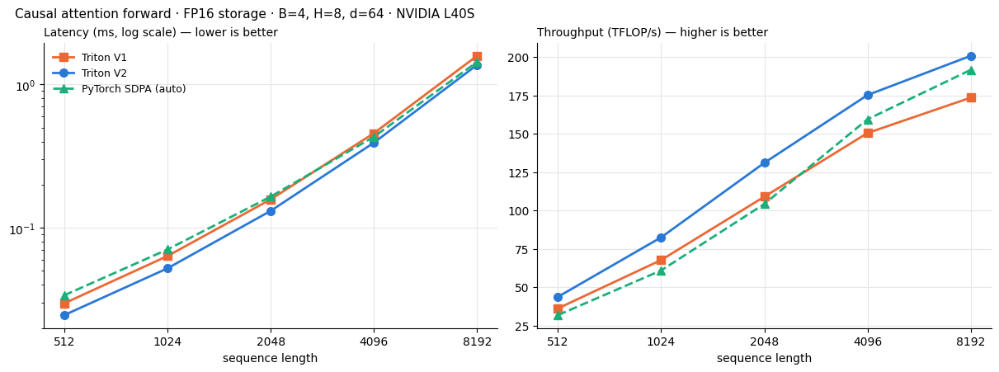
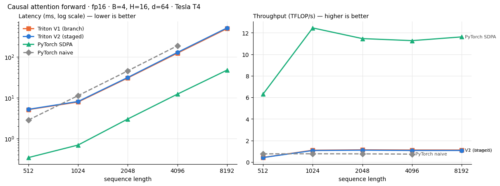

# ⚡ FlashAttention Forward Pass in Triton

[](https://colab.research.google.com/github/AvinashQtC/-flash-attention-triton/blob/main/flash_attention_forward_triton_l40s.ipynb)

A from-scratch **causal FlashAttention forward kernel** written in [Triton](https://triton-lang.org), in two versions that compute the same thing but handle the causal mask differently:

| | Kernel | How the causal mask is handled |
|---|---|---|
| **V1** | `_fwd_v1_branch` | One loop over all KV tiles. A **runtime `if`** inside the loop masks tiles that touch the diagonal, and every tile pays for boundary masks. |
| **V2** | `_fwd_v2_staged` | The loop is split into **two compile-time stages** (`STAGE: tl.constexpr`). Off-diagonal tiles run with **no masks**, and only the diagonal tile is masked. |

On an **NVIDIA L40S**, V2 reaches **201 TFLOP/s** in FP16 at N = 8192, which is **16% faster than V1** and **5% faster than PyTorch SDPA**. All 36 correctness checks pass against an FP64 reference.

| Notebook | GPU | Contents |
|---|---|---|
| [`flash_attention_forward_triton_l40s.ipynb`](flash_attention_forward_triton_l40s.ipynb) | L40S (Ada, `sm_89`) | **Current version:** base-2 softmax, FP16/FP32 IEEE/TF32 modes, FP64 error harness, benchmarks |
| [`flash_attention_forward_triton.ipynb`](flash_attention_forward_triton.ipynb) | Tesla T4 (Turing, `sm_75`) | First version, kept for reference |

## The algorithm

For one (batch, head) with $Q, K, V \in \mathbb{R}^{N\times d}$, causal attention is $O = \mathrm{softmax}(QK^\top/\sqrt d + M)\,V$. FlashAttention streams K and V through on-chip SRAM in tiles and never materialises the $N\times N$ score matrix. For each new tile it updates a running max $m$, normaliser $\ell$ and un-normalised output:

$$
m^{\text{new}} = \max\big(m,\ \operatorname{rowmax}(S_j)\big),\qquad
\alpha = e^{m - m^{\text{new}}},\qquad
\ell \leftarrow \alpha\ell + \operatorname{rowsum} e^{S_j - m^{\text{new}}},\qquad
\mathrm{acc} \leftarrow \alpha\,\mathrm{acc} + e^{S_j - m^{\text{new}}} V_j .
$$

**Base-2 softmax.** The kernels fold the softmax scale and $\log_2 e$ into one constant $c = \log_2 e/\sqrt d$ and keep $m$ in base-2 units. Each score then costs one FMA (`qk * c - m`) plus one `exp2` on the special-function unit. The stored log-sum-exp is converted back with $L = \ln 2\,(m + \log_2 \ell)$.

```python
m_new = tl.maximum(m, tl.max(s, axis=1) * qk_scale)   # qk_scale = log2(e) / sqrt(d)
p     = tl.exp2(s * qk_scale - m_new[:, None])         # one FMA + one MUFU.EX2
alpha = tl.exp2(m - m_new)
```

**Where the mask matters.** With equal Q and KV tile sizes, only the $n$ diagonal tiles out of $n(n+1)/2$ need a causal mask, a fraction $2/(n+1)$ (1.6% at N = 8192). V2 compiles a mask-free loop for the off-diagonal tiles and a masked one for the diagonal tile. V1 checks every tile at runtime.

A NumPy version of the tiled base-2 algorithm in the notebook matches the naive formula to about 1e-15 for both O and L.

## Correctness (L40S)

Q, K and V are upcast once to FP64, so the reference and the kernels see the same quantised inputs and any difference comes from the kernel's arithmetic. FP16 smoke test, B=2, H=4, N=256, d=64:

| | max\|Δ\| | mean\|Δ\| | rel L2 |
|---|---:|---:|---:|
| exact output rounded to FP16 (floor) | 9.70e-4 | 2.45e-5 | 1.99e-4 |
| PyTorch SDPA FP16 | 9.83e-4 | 3.44e-5 | 2.42e-4 |
| Triton V1 / V2 | 9.83e-4 | 3.42e-5 | 2.41e-4 |

Both kernels match SDPA and sit about 20% above the FP16 rounding floor, so accumulation and the online softmax add essentially no error.

The full test suite checks O and the natural-log LSE across three numeric modes, five shapes (including N = 77, 300 and d = 16, 128) and a non-contiguous BSHD layout. **36/36 pass.**

| Mode | Typical max\|ΔO\| | Typical max\|ΔL\| | Tolerance |
|---|---:|---:|---:|
| FP32 IEEE | ~6e-7 | ~1e-6 | 2e-5 |
| FP32 TF32 | ~3e-3 | ~2e-3 | 5e-3 |
| FP16 | ~9e-4 | ~1e-6 | 1e-2 |

## Performance (L40S, causal, B=4, H=8, d=64)

FLOPs count the two matmuls only: $2BHN^2d$ for causal attention. Timings use `triton.testing.do_bench` (median).



**FP16:**

| N | SDPA (ms) | V1 (ms) | V2 (ms) | V2 TFLOP/s | V2 vs V1 | V2 vs SDPA |
|---:|---:|---:|---:|---:|---:|---:|
| 512  | 0.034 | 0.030 | 0.025 | 43.7  | 1.21× | 1.37× |
| 1024 | 0.071 | 0.063 | 0.052 | 82.4  | 1.22× | 1.35× |
| 2048 | 0.165 | 0.158 | 0.131 | 131.0 | 1.20× | 1.26× |
| 4096 | 0.431 | 0.457 | 0.392 | 175.2 | 1.16× | 1.10× |
| 8192 | 1.435 | 1.584 | 1.369 | 200.8 | 1.16× | 1.05× |

**FP32, TFLOP/s at N = 8192:**

| Mode | SDPA | V1 | V2 |
|---|---:|---:|---:|
| FP32 IEEE | 23.8 | 21.2 | 18.8 |
| FP32 TF32 | 23.0 | 71.2 | 87.2 |

Plots: [FP32 IEEE](assets/benchmark_fp32_ieee_l40s.png) · [FP32 TF32](assets/benchmark_fp32_tf32_l40s.png)

**Takeaways**

- **Staging the mask pays off on Ada.** V2 is 16–22% faster than V1 in FP16 at every length, unlike on the T4, where it was 2–4% slower.
- **Base-2 softmax helped.** Folding $\log_2 e$ into the scale raised V2 from 186.5 to 200.8 TFLOP/s at N = 8192, while SDPA moved about 1% between the same two runs.
- **TF32:** V2 reaches 87 TFLOP/s, about 3.8× SDPA. SDPA's numbers barely change between the IEEE and TF32 suites, so its FP32 attention path doesn't use TF32 tensor cores.
- **Open question, FP32 IEEE:** V2 is slower than V1 in strict FP32 (18.8 vs 21.2 TFLOP/s at N = 8192; 5.6 vs 9.5 at N = 512). The likely causes are register pressure from inlining the loop body twice, or a worse autotuned tile for CUDA-core `tl.dot`. Profiling this with Nsight Compute is the next step.

## Run it

Use the Colab badge above with a GPU runtime, or run locally on an NVIDIA GPU. The TF32 mode needs Ampere or newer.

```bash
pip install torch triton numpy pandas matplotlib
jupyter notebook flash_attention_forward_triton_l40s.ipynb
```

Tested with torch 2.13.0+cu130 and Triton 3.7.1. The benchmark cell writes plots and CSVs to `assets/`.

To check which unit limits a kernel (tensor cores vs the `exp2` special-function unit), see the Nsight Compute section at the end of the notebook.

## Next steps

- [x] `exp2` with log₂e folded into the softmax scale
- [ ] Nsight Compute profile of V1/V2, including the FP32 IEEE regression
- [ ] Backward pass (`L` is already returned)
- [ ] Non-causal mode and variable-length (packed) sequences
- [ ] GQA / MQA
- [ ] A `torch.autograd.Function` wrapper

## Earlier results: Tesla T4 (`sm_75`)

The first notebook ran on a T4 in FP16 with B=4, H=16, d=64 and compared against a naive PyTorch implementation as well. On Turing, V2 was 2–4% slower than V1, and both kernels reached about 1.1 TFLOP/s against 11–12 TFLOP/s for SDPA. Turing has no `cp.async`, so software pipelining did little there.



## References

1. T. Dao et al., *FlashAttention: Fast and Memory-Efficient Exact Attention with IO-Awareness*, NeurIPS 2022. [arXiv:2205.14135](https://arxiv.org/abs/2205.14135)
2. T. Dao, *FlashAttention-2: Faster Attention with Better Parallelism and Work Partitioning*, 2023. [arXiv:2307.08691](https://arxiv.org/abs/2307.08691)
3. M. Milakov, N. Gimelshein, *Online normalizer calculation for softmax*, 2018. [arXiv:1805.02867](https://arxiv.org/abs/1805.02867)
4. Triton tutorial: [Fused Attention](https://triton-lang.org/main/getting-started/tutorials/06-fused-attention.html)
